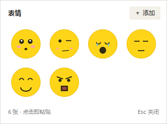
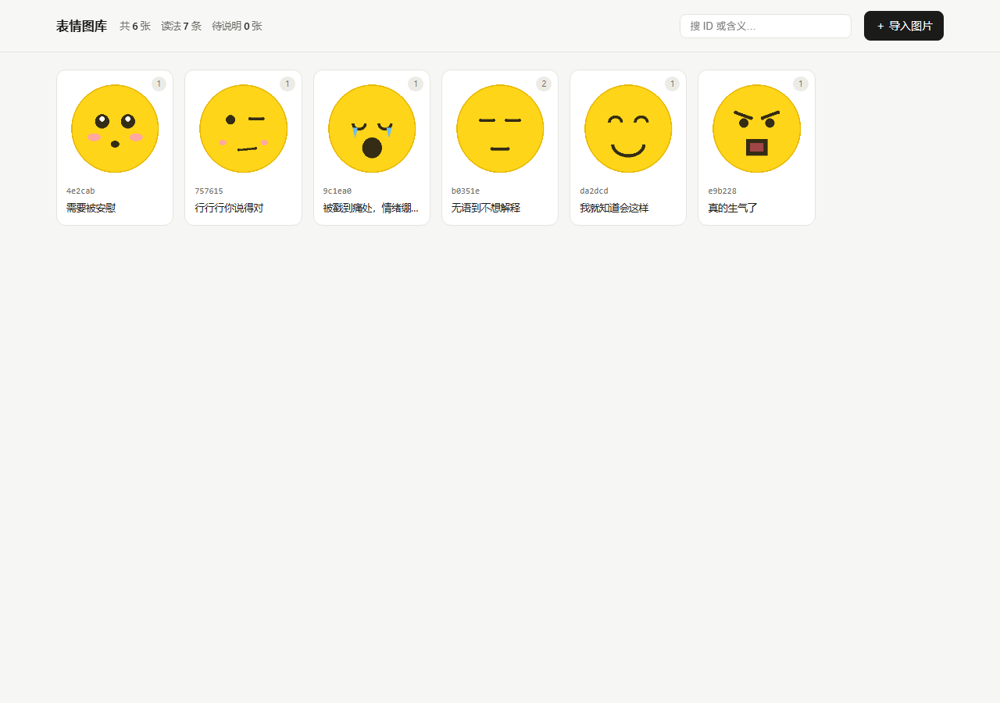
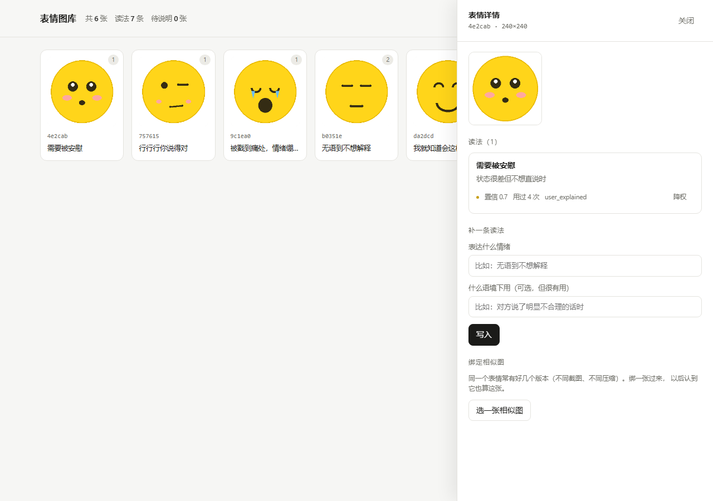

# sticker-sense

给你的 AI 一个能"读懂"的表情包图库。

你发表情，它知道你在说什么情绪；你解释一次，它下次就记住。所有数据都在本地。



## 它解决什么问题

AI 看得见表情包的画面，但不懂梗。同一个"微笑"，可能是礼貌敷衍，也可能是"我现在很想打人"。这种差别不在像素里，在你们共同的使用史里。

所以这个项目不训练模型，而是**外挂一层语义记忆**：

- 一张表情可以有**多条读法**，每条带语境提示
- 你解释一次，它写进库；下次同一语境再出现，直接用
- 读法只影响 AI 的**语气**，不会让它复述"我识别到这是第 3 号表情"——那样聊天感就毁了

三个入口都通了：**桌面挂件**（点一下粘进输入框）、**MCP server**（AI 自己调）、**网页管理端**（批量维护）。

## 快速开始

```bash
git clone <this-repo> && cd sticker-sense
python -m venv .venv
.venv/bin/pip install -r requirements.txt      # Windows: .venv\Scripts\pip install -r requirements.txt

# 0. 先看看效果（生成 6 张示例小黄脸并写入读法）
python scripts/make_demo.py && python scripts/seed_demo.py

# 1. 导入自己的表情包（整个目录也行）
python -m sticker_sense.cli import ./我的表情包

# 2. 看看导入了什么
python -m sticker_sense.cli list

# 3. 给某张写读法（这才是"训练"）
python -m sticker_sense.cli tag b0351e "无语到不想解释" --context "对方说了明显不合理的话时"
python -m sticker_sense.cli tag b0351e "礼貌性敷衍" --context "不想继续这个话题但不好直接拒绝"

# 4. 拿一张图问它这是什么（也可以直接喂降质后的图）
python -m sticker_sense.cli identify ./某张截图.png

# 5. 打开网页管理端（导图、看读法、改绑定）
python -m sticker_sense.cli admin

# 6. 接进 AI（二选一或都装）
python hooks/install_mcp.py      # MCP server：让 AI 自己调
python hooks/install_hooks.py    # 桌面挂件：点球弹面板
```

数据默认在 `./data`，用 `--data` 换位置，或者设 `STICKER_DATA` 环境变量。

## 三种入口

### 一、桌面挂件（Windows）


装一次，之后跟着 agent 自动起停。点球弹面板，点表情直接粘进输入框。

```bash
python hooks/install_hooks.py            # 安装
python hooks/install_hooks.py --remove   # 卸载
```

### 二、MCP server

```bash
python hooks/install_mcp.py
```

会往 `~/.workbuddy-ai/mcp.json` 写一条 `sticker-sense`（也支持 `--config` 指定 Claude Desktop 的配置）。重启客户端后对这个 server 点「信任」。

之后 AI 就能自己调这 7 个工具：

| 工具 | 方向 | 作用 |
|---|---|---|
| `identify` | 用户 → AI | 认一张图，返回 ID + 全部读法 |
| `last_pick` | 用户 → AI | 取用户刚在挂件里点的 ID（比图像识别准，3 分钟内有效） |
| `list` | 查询 | 列出图库 |
| `show` | 查询 | 看某张的全部读法 |
| `tag` | AI → 库 | 写入一条读法（唯一的"训练"入口） |
| `import` | AI → 库 | 导入图片或目录 |
| `pick` | AI → 用户 | **反向**：AI 从图库里挑一张发给你 |

协议是 stdio 上的 JSON-RPC 2.0，手写的，没有 MCP SDK 依赖。`scripts/test_mcp.py` 真起进程跑协议，18 项断言。

### 三、网页管理端



```bash
python -m sticker_sense.cli admin            # 默认 http://127.0.0.1:8777
python -m sticker_sense.cli admin --port 9000 --no-open
```

批量拖图导入、逐张看读法、补读法、绑定相似图、对误判的读法**降权**。支持 `#<id>` 直链。

只绑 `127.0.0.1`，只在本机开。



## 入口为什么这么难做

这是整个项目最容易做错的地方，所以单独说。

**MCP 协议做不出"输入框下方的常驻按钮"**。MCP Apps 的 `ui://` 组件只能渲染在工具调用的结果气泡里，宿主不给你往输入框区域注入 UI 的权限。所以常驻按钮只有两条路：改客户端源码，或者写浏览器扩展（每个站点单独适配 DOM，改版就坏）。

实际可用的入口，按体验排：

| 入口 | 怎么做 | 代价 |
|---|---|---|
| **桌面挂件** | 装一次 hook，之后跟着 agent 自动起停；点球弹面板，点表情自动粘进输入框 | 需要一次安装 + 重启客户端 |
| **MCP 工具** | AI 自己调 `identify` / `pick` | 需要客户端支持 MCP |
| 斜杠命令 | 输入 `/sticker`，AI 渲染面板，点击回传 ID | 要打字，零安装 |
| 独立网页 | `page` 生成 HTML，点表情复制标记到剪贴板 | 要切窗口 |

### 挂件怎么跟着 agent 起停

用 WorkBuddy / CodeBuddy 的 **SessionStart hook**，不碰系统开机启动项：

```bash
python hooks/install_hooks.py            # 安装
python hooks/install_hooks.py --remove   # 卸载
```

它会往 `~/.workbuddy-ai/settings.json` 的 `hooks.SessionStart` 写一条命令，
每次会话启动时拉起挂件。

三个实现要点：

- **fail-open**：hook 里任何异常都静默退出 0。挂件没装好、Python 没配好，
  agent 照常启动，绝不阻塞。
- **立刻返回**：hook 默认 60 秒超时，所以只 fire-and-forget，不等待。
- **单实例**：靠命名互斥量去重，重复触发无害。

还有一个不那么显然的坑：**hook 的子进程会被连带杀掉**。agent 通常把 hook
放在 Windows Job Object 里执行，命令一结束就回收整棵进程树。实测
`CREATE_BREAKAWAY_FROM_JOB` 会被拒绝（`WinError 5`，作业不允许 breakaway），
所以拉起挂件走的是 WMI 的 `Win32_Process.Create`——进程由 `WmiPrvSE` 服务创建，
父进程不是 hook，天然不在那个作业里，能活到用户关掉 agent。
WMI 不可用时才退回普通 detached。

装完必须**完全退出客户端再启动**——hook 配置在启动时缓存，热改无效；
点窗口关闭按钮不算退出，要真正结束进程。

### 挂件怎么约束在 agent 窗口内

不是满屏乱飘的悬浮球。三个机制：

- 用 `EnumWindows` 按进程名找到 agent 主窗口，`GetWindowRect` 拿到矩形
- **前台跟随**：宿主在前台才置顶显示，切到别的应用就收起。这样既不会被
  宿主窗口盖住，也不会飘在别人的窗口上面
- 拖动时把坐标夹在宿主矩形内，面板弹出位置也夹在同一范围

试过用 `SetWindowLongPtr(GWLP_HWNDPARENT)` 把自己设成宿主的附属窗口，但
tk 的 `overrideredirect` 窗口上这个调用不生效（`GetWindow(GW_OWNER)` 恒为 0），
所以改用前台跟随。

宿主窗口消失（agent 重启换了新句柄）时，挂件**不退出**，而是重新找宿主接着跟——
如果这里自杀，新会话的 hook 又会被单实例互斥量挡掉，最后两头落空。
连续五分钟找不到宿主才结束进程。

### 挂件怎么把表情塞进输入框

点表情时同时往剪贴板写两种格式——`CF_DIB`（图片）和 `CF_UNICODETEXT`
（`[sticker:id]` 标记）。富文本输入框优先粘图片，纯文本框退化成粘标记，
两种都不会落空。然后恢复焦点到原窗口、模拟 `Ctrl+V`。

焦点恢复用 `AttachThreadInput` 绕过 Windows 的前台锁，否则 `SetForegroundWindow` 会静默失败。

这里有个容易漏掉的细节：**点球这个动作本身会把前台抢到挂件身上**。所以记录
"粘贴目标"时必须排掉自己的窗口，否则记下来的是挂件自己，粘回去就粘进挂件里了。
`clipboard.pick_target()` 负责这件事——前台不是自己就用前台，是就退回宿主窗口。

关键设计：**点击回传的是 ID，不是图片**。ID 精确、零误差，绕开了图像识别的所有不确定性。
挂件粘贴图片时会把 ID 写进 `data/last_pick.json`，AI 读它就能拿到精确身份
（MCP 的 `last_pick` 工具就是干这个的）。
只有用户直接粘贴别处的图片时，才退回 dHash 指纹识别。

## 识别是怎么做的

三级指纹，级联匹配。这里的选择都是被实测逼出来的，不是拍脑袋：

| 层级 | 内容 | 解决什么 |
|---|---|---|
| sha256 | 文件字节 | 同一文件精确命中，零成本 |
| 粗筛 | 8×8 dHash × 4 个裁剪尺度 | 压缩、缩放、裁剪后仍能命中 |
| 细排 | 16×16 dHash + 颜色色度网格 | 区分"同模板换字/换色"的姐妹表情 |

几个踩过的坑，写下来免得再踩：

- **单尺度 dHash 扛不住裁剪**。用户截图裁掉 15%，汉明距离从 0 跳到 25，直接认不出。所以存 100%/85%/70%/55% 四个尺度的中心裁剪指纹。
- **8×8 dHash 分不清同模板表情**。64 位太粗，两个字形的差别在网格里都糊成"中间一坨"。所以加 16×16 做细排。
- **绝对 RGB 做颜色指纹会被亮度带偏**。测过一次 +15% 亮度就把正确结果挤成误判。改成存色度 `(r/s, g/s)`，亮度无关。
- **不用 CLIP embedding**。这里要解决的是"认出同一张图"，不是"找到语义相似的图"。CLIP 会把所有"无语"的表情判成高度相似，正好让问题更糟。

匹配不只看分数，还看 **margin**（最佳与次佳的分数差）。margin 太小就标 `ambiguous`，宁可说"不确定"也不自信地认错。

阈值都在 `sticker_sense/hashing.py` 顶部，按自己的图库分布调。

## 数据长什么样

三张表，SQLite + WAL（管理端和 AI 服务是两个进程并发写，JSON 加锁在 Windows 上很难做对）：

- `stickers`：一张图一行，存 sha256 和多尺度指纹
- `readings`：一张表情可以挂多条读法，`meaning` + `context_hint` + `confidence` + `uses`
- `aliases`：人工绑定的相似图（同一表情的不同截图版本）

**读法只降权，不硬删**。管理端的"降权"把 confidence 打到 0.4 倍，删了就再也找不回来，降权还能反悔。

想拿人类可读的版本：`python -m sticker_sense.cli export out.json`。

## 自测

```bash
python scripts/make_demo.py       # 生成 6 张示例小黄脸
python scripts/selftest.py        # 识别：正样本 5 项 + 负样本 4 项
python scripts/test_mcp.py        # MCP 协议：真起进程跑 JSON-RPC，18 项
python scripts/test_admin.py      # 管理端：真起 HTTP server 打接口，15 项
python scripts/diagnose.py        # 打印降质探针与全库的打分矩阵，用来调阈值
```

当前基线：识别 9/9（压缩、放大、裁剪、调亮度、截图转发全部命中；库里没有的图全部拒绝），MCP 18/18，管理端 15/15。CI 在 Ubuntu + Windows × Python 3.10/3.12 上跑这三套。

## 命令一览

| 命令 | 作用 |
|---|---|
| `import <路径>` | 导入图片或目录，按 sha256 去重 |
| `identify <图片>` | 识别，返回命中的表情与全部读法 |
| `tag <id> <含义>` | 写入一条读法，`--context` 给语境提示 |
| `show <id>` | 查看某个表情的全部读法 |
| `list` | 列出图库 |
| `use <id>` | 记一次使用，让高频读法排到前面 |
| `alias <id> <图片>` | 人工绑定：告诉库这张图属于哪个 id |
| `export <out.json>` | 导出人类可读的 JSON |
| `picker` | 输出可点击面板的 HTML 片段（内联 widget 用） |
| `page [out.html]` | 生成独立的可点击面板网页 |
| `widget` | 启动桌面悬浮挂件（需 tkinter，Windows） |
| `mcp` | 以 MCP server 运行（stdio JSON-RPC） |
| `admin` | 启动本地网页管理端 |

## 平台支持

| 能力 | Windows | macOS / Linux |
|---|---|---|
| 图库 / 识别 / 读法 | ✅ | ✅ |
| MCP server | ✅ | ✅ |
| 网页管理端 | ✅ | ✅ |
| 桌面挂件 | ✅ | ❌ 未实现（依赖 Win32 剪贴板与窗口 API） |

挂件部分用了大量 Win32 调用（`AttachThreadInput`、`PrintWindow`、Job Object），
macOS 需要另写一套 NSPasteboard + Accessibility 实现，欢迎 PR。

## 路线图

- [x] 图库 + 三级指纹 + 多义读法
- [x] 负样本拒绝与歧义标记
- [x] 点击回传入口（内联 widget，点击发出带 ID 的标记）
- [x] 独立面板网页（不依赖客户端能力）
- [x] 桌面悬浮挂件（点一下自动粘进输入框）
- [x] MCP server（AI 自己调 identify / tag / pick）
- [x] 最小网页管理端（批量导图、看读法、改绑定）
- [x] 反向能力：AI 也能从同一个库挑表情发给你
- [ ] macOS 挂件
- [ ] 读法自动聚类（把语义重复的读法合并，减少手工维护）

## 版权

仓库不内置任何表情包。`demo/` 里的占位图由 `scripts/make_demo.py` 生成，仅用于测试。

表情包绝大多数是影视、动漫、明星截图，二次分发有实际风险，请只导入自己有权使用的图片。

## License

MIT
